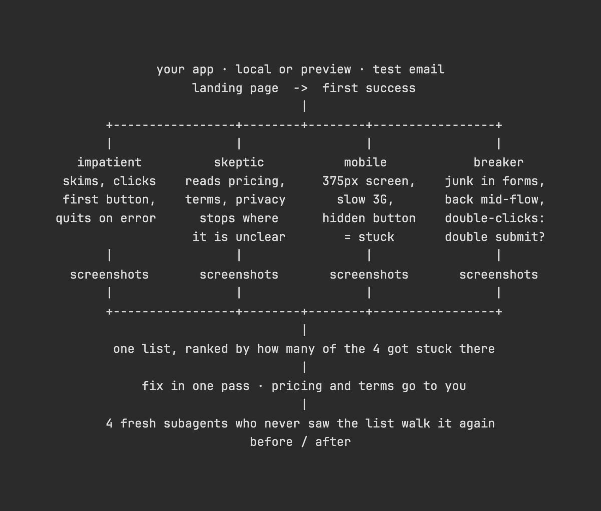

# Проверка первых пользователей четырьмя агентами — пересланная заметка

Совет: перед запуском продукта попросите агента отправить четырёх субагентов, которые будут имитировать новых пользователей, чтобы проверить весь путь от открытия главной страницы до первого успешного действия.

Каждый раз, когда кто-то из них не понимает, что делать дальше, застревает или хочет закрыть вкладку, проблема попадает в общую таблицу со скриншотом.

→ Нетерпеливый пользователь: бегло просматривает страницу, нажимает первую попавшуюся кнопку и закрывает вкладку при первой ошибке.

→ Скептик: изучает цены, условия использования и политику конфиденциальности перед регистрацией. Останавливается на всём, что кажется непонятным.

→ Пользователь смартфона: экран шириной 375 пикселей и медленное 3G-соединение. Скрытая кнопка или горизонтальная прокрутка считаются проблемой.

→ Тестировщик на прочность: вводит некорректные данные во все формы, возвращается назад на полпути и дважды нажимает кнопки, чтобы проверить, не выполняется ли действие повторно.

Проблемы в таблице сортируются по количеству агентов, которые с ними столкнулись. Исправьте всё, что можно устранить за один проход, а затем отправьте четырёх новых субагентов, которые не видели таблицу с проблемами, чтобы они повторно прошли тот же путь и проверили, остались ли препятствия.

Чтобы получить такую таблицу перед запуском, отправьте агенту следующий промпт:

«Мой продукт скоро запускается. Помоги найти места, на которых первые пользователи могут столкнуться с трудностями.

Сначала проверь, доступен ли тебе браузерный MCP. Если нет, остановись и дай мне команду для установки Playwright MCP.

Изучи код, определи, какое действие считается первым успешным результатом для пользователя, и укажи его в начале отчёта.

Затем запусти четырёх субагентов, каждый из которых будет имитировать нового пользователя. Они должны работать с браузером по очереди: следующий начинает только после завершения предыдущего.

1. Нетерпеливый пользователь: бегло просматривает страницу, нажимает первую кнопку и закрывает вкладку при первой ошибке.
2. Скептик: изучает цены, условия использования и политику конфиденциальности перед регистрацией. Останавливается везде, где что-то непонятно.
3. Пользователь смартфона: использует экран шириной 375 пикселей и медленное 3G-соединение. Если ограничить скорость сети невозможно, сообщи об этом.
4. Тестировщик на прочность: вводит некорректные данные в формы, возвращается назад посреди процесса и дважды нажимает кнопки.

Каждый субагент должен пройти путь от главной страницы до первого успешного результата.

Делай скриншоты всех мест, где субагенты испытывают затруднения, застревают или хотят закрыть вкладку. Сохраняй их в qa/first-users/ и фиксируй этап, увиденное и действие, которое пользователь пытался выполнить.

В конце каждый субагент должен сообщить, вернулся бы он к продукту и сколько кликов потребовалось для достижения первого успешного результата.

Работай только в локальной среде или превью-окружении. Для регистрации используй тестовый адрес электронной почты, а для платежей — тестовый режим.

Считай одинаковые проблемы, возникающие в одном месте на одной странице, одной проблемой. Отсортируй их по количеству пользователей, которые с ними столкнулись.

Проблемы с ценами, условиями использования и политикой конфиденциальности просто зафиксируй для меня.

Все остальные проблемы исправь за один проход.

Затем запусти четырёх новых субагентов, которые не видели список обнаруженных проблем. Пусть они повторят тестирование в тех же условиях.

В конце предоставь сравнение результатов до и после исправлений».

