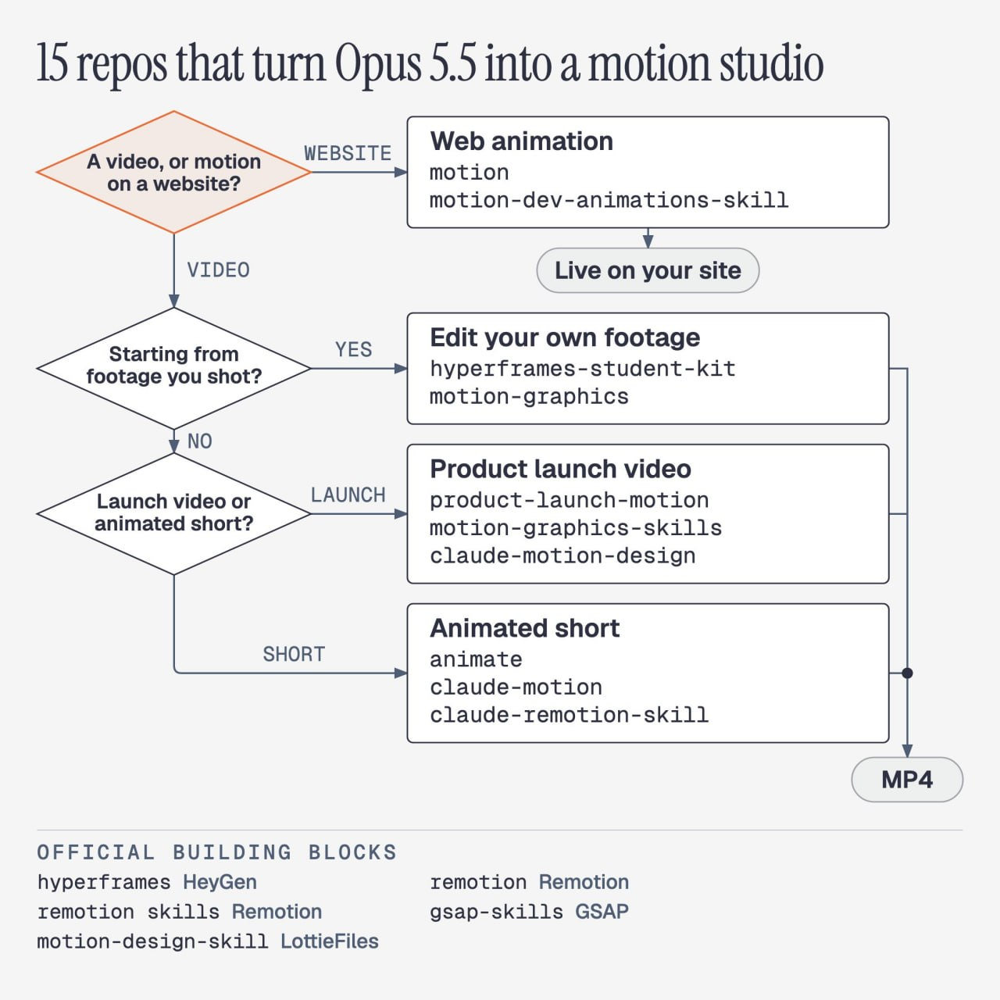

# 15 репозиториев для моушн-дизайна с AI

Эти 15 репозиториев на GitHub превращают ваш Opus 5.5 в полноценную студию моушн-дизайна.

Даже команды HeyGen, Remotion, GSAP и LottieFiles подключились, чтобы сами научить ИИ моушн-дизайну.

Я отобрал официальные репозитории и проекты сообщества и сгруппировал их по задачам. Установите их — и сможете создавать ролики для запуска продуктов, монтировать собственные видео и делать короткие анимации.

Ролики для запуска продуктов

→ product-launch-motion: дайте ему свой продукт — он напишет сценарий, добавит закадровый голос, настроит движение камеры и цветокоррекцию и доведёт всё до готового презентационного ролика.

https://github.com/AbubakrChan/product-launch-motion

→ motion-graphics-skills: 13 навыков для презентационных роликов, анимированных диаграмм и коротких видео. Автор рекомендует сначала переключиться на Opus 5.5.

https://github.com/charlie947/motion-graphics-skills

→ claude-motion-design: изображение и звук попадают в ритм музыки. Автор создал с его помощью собственный презентационный ролик на Opus 5.5 за пять итераций.

https://github.com/howseen-ai/claude-motion-design

Монтаж собственных видео

→ hyperframes-student-kit: дайте ему отснятый материал — он вырежет паузы и оговорки, сделает повествование более собранным, а затем добавит анимированную графику.

https://github.com/nateherkai/hyperframes-student-kit

→ motion-graphics: добавляет анимацию прямо в те моменты, когда вы говорите. Также умеет отделять человека от фона.

https://github.com/Barty-Bart/motion-graphics

Короткие анимационные ролики

→ animate: короткие объясняющие ролики в семи стилях, включая бумажную аппликацию, ризографию и пиксельную графику. Перед началом работы показывает раскадровку.

https://github.com/cth9191/animate

→ claude-motion: прививает ИИ художественный вкус, заставляет его пересматривать собственные кадры в поисках проблем и позволяет создавать свои звуковые эффекты.

https://github.com/whaleyxbt/claude-motion

→ claude-remotion-skill: в видео, созданных ИИ, движения часто выглядят скованными. Этот навык помогает это исправить.

https://github.com/haidrrrry/claude-remotion-skill

Анимация для сайтов

→ motion: анимирует кнопки, карточки и переходы между страницами вашего сайта.

https://github.com/motiondivision/motion

→ motion-dev-animations-skill: одно предложение — и Claude Code добавляет анимацию на ваш сайт.

https://github.com/199-biotechnologies/motion-dev-animations-skill

Официальные проекты

→ hyperframes: проект с открытым исходным кодом от HeyGen, созданный для работы с ИИ. ИИ пишет веб-страницу, а Hyperframes превращает её в видео.

https://github.com/heygen-com/hyperframes

→ remotion: сам Remotion, теперь ориентированный на то, чтобы ваш ИИ мог превращать идею непосредственно в видео.

https://github.com/remotion-dev/remotion

→ remotion skills: официальное руководство Remotion для ИИ.

https://github.com/remotion-dev/skills

→ gsap-skills: официальный навык для GSAP — давно существующей библиотеки анимации, на которой основаны упомянутые выше наборы для презентационных роликов и монтажа.

https://github.com/greensock/gsap-skills

→ motion-design-skill: LottieFiles адаптировала принципы анимации Disney для ИИ: с какой скоростью должны двигаться объекты и что должно двигаться первым. Работает с любым инструментом.

https://github.com/LottieFiles/motion-design-skill

Сохраните этот пост и вернитесь к нему, когда понадобится сделать видео.
